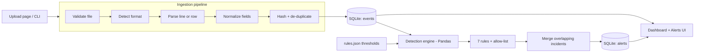

# Mini-SIEM — Security Log Monitoring and Threat Detection System


A working SIEM prototype that ingests web-server, Linux and Windows authentication logs, normalizes them
into one event schema, runs seven configurable detection rules, and gives a SOC-style dashboard for
triaging the alerts. Everything runs locally with Python, Flask, SQLite and Pandas: no cloud services,
no API keys.

> Built as an MCA cybersecurity portfolio project to show the core SOC workflow end to end:
> **collect → parse → normalize → detect → alert → triage → tune.**

---

## Features

| Area | What it does |
|---|---|
| **Log ingestion** | Upload `.log`, `.txt` or `.csv` files (several at once) or use the CLI. Auto-detects Apache/Nginx access logs, Linux `auth.log` / `secure`, and CSV (including Windows Security 4624/4625 exports). |
| **Validation** | Refuses binary, empty or wrong-type files; rejects malformed lines individually with a reason; shows **processed / rejected / duplicate** counts and sample rejected lines per file. |
| **Normalization** | One schema for every source: UTC timestamps (any offset or a chosen time zone), validated IPv4/IPv6 (ports and brackets stripped), usernames (`DOMAIN\user` → `user`), canonical event types and HTTP status codes. Missing fields are allowed. |
| **De-duplication** | Re-uploading a file or an overlapping log export never stores an event twice, while genuine repeated lines (floods) are kept. |
| **Detection engine** | 7 rules: brute force, suspicious IP, HTTP error spikes, request flooding, sensitive-path probing, suspicious user agents, failed-then-successful login. All thresholds editable in the UI; all use event timestamps, never file order. |
| **Alerts** | Severity, MITRE ATT&CK mapping, plain-English description, evidence events, recommended response. One alert per incident, updated (not duplicated) when an attack continues. |
| **Triage** | Status workflow (open → investigating → resolved / false positive), analyst notes, automatic re-open when a resolved incident shows new activity, CSV export. |
| **Dashboard** | KPIs, activity timeline, alerts by severity and rule, HTTP status and event-type breakdowns, top source IPs, latest alerts. Chart.js + Bootstrap 5. |
| **Hardening** | CSRF tokens, strict Content-Security-Policy (no inline scripts), output escaping, CSV-formula-injection protection, upload size limit, open-redirect protection, binds to localhost by default. |
| **Tests** | ~150 pytest cases covering parsers, normalization, every rule (positive, negative, unsorted input), de-duplication and the web app. GitHub Actions on Windows and Ubuntu. |

## Architecture



1. **Ingestion** (`siem/ingestion/`) reads a file, picks a parser, turns each record into a normalized event
   and stores it with a de-duplication hash. Bad records are counted, not fatal.
2. **Detection** (`siem/detection/`) loads events into a Pandas DataFrame, sorts by timestamp, removes
   allow-listed IPs and runs each enabled rule. Sliding-window rules share one O(n) burst finder.
3. **Alert storage** merges a new detection into an existing alert when the rule, the entity and the
   time range overlap, so re-running detection is idempotent.
4. **Web UI** (`siem/web/`, `siem/templates/`) is a Flask app; the dashboard reads `/api/stats`.

## Project structure

```
mini-siem/
├── run.py                      # start the web app
├── requirements.txt / pyproject.toml
├── siem/
│   ├── __init__.py             # Flask app factory
│   ├── db.py                   # SQLite schema and queries
│   ├── cli.py                  # command line: ingest / detect / alerts / samples / reset
│   ├── samples.py              # synthetic log generator with attack scenarios
│   ├── ingestion/
│   │   ├── normalizer.py       # timestamps, IPs, usernames, event types
│   │   ├── parsers.py          # access log, auth.log, CSV parsers + format detection
│   │   └── pipeline.py         # validation, de-duplication, stats
│   ├── detection/
│   │   ├── base.py             # Rule / Param / Alert building blocks
│   │   ├── windows.py          # sliding-window burst detection
│   │   ├── rules.py            # the 7 detection rules
│   │   ├── config.py           # thresholds: defaults, JSON load/save, validation
│   │   └── engine.py           # run rules, allow-list, persist + de-duplicate alerts
│   ├── web/                    # routes, JSON API, dashboard stats, security helpers
│   ├── templates/              # Jinja2 + Bootstrap pages
│   └── static/                 # CSS, JS (dashboard.js), vendor/ for offline libraries
├── sample_logs/                # access.log, auth.log, windows_security.csv
├── scripts/
│   ├── generate_sample_logs.py
│   ├── vendor_assets.py        # download Bootstrap + Chart.js for offline use
│   └── export_windows_security_events.ps1
├── tests/                      # pytest suite
└── docs/
    ├── DETECTION_RULES.md      # how every rule works, thresholds, MITRE, false positives
    └── PORTFOLIO.md            # resume bullets, demo script, interview questions
```

## Quick start

### Windows 11 (PowerShell)

```powershell
git clone https://github.com/<your-username>/mini-siem.git
cd mini-siem
py -m venv .venv
.\.venv\Scripts\Activate.ps1          # if blocked: Set-ExecutionPolicy -Scope CurrentUser RemoteSigned
pip install -r requirements.txt
python run.py
```

Open <http://127.0.0.1:5000> and click **Load sample data**.

### Kali Linux / Ubuntu

```bash
git clone https://github.com/<your-username>/mini-siem.git && cd mini-siem
python3 -m venv .venv && source .venv/bin/activate
pip install -r requirements.txt
python run.py
```

Running Kali in VirtualBox and want to open the dashboard from Windows? Start it with
`python run.py --host 0.0.0.0` and browse to the VM's IP. Only do this on a host-only or NAT network:
the app has no login page.

### Working offline

The pages load Bootstrap and Chart.js from the jsDelivr CDN. Run `python scripts/vendor_assets.py` once
while online and the app will use local copies from `siem/static/vendor/` from then on.

## Using it

1. **Ingest** – *Ingest logs* page: choose files, leave the format on *Auto-detect*, set the time zone
   for logs whose timestamps carry no offset (Linux `auth.log` – e.g. `Asia/Kolkata`), keep
   *Run detection after import* ticked. The result table shows records, processed, rejected and duplicates
   per file, plus why lines were rejected.
2. **Review** – *Dashboard* for the big picture, *Alerts* for the triage queue (sorted by severity),
   *Events* for searching raw logs by IP, user, type, status, time range or free text.
3. **Investigate** – open an alert to see what happened, the evidence events, the MITRE technique, the
   recommended response and other alerts for the same IP. Set the status and add notes.
4. **Tune** – *Detection rules*: change thresholds, disable rules, or allow-list trusted IPs/CIDRs
   (your monitoring host, vulnerability scanner, load balancer). Save, or save and re-run.

### Command line

```bash
python -m siem.cli ingest /var/log/auth.log access.log --tz Asia/Kolkata
python -m siem.cli detect
python -m siem.cli alerts --severity critical
python -m siem.cli samples           # regenerate sample_logs/
python -m siem.cli reset --yes
```

The CLI and the web app share the same database (`instance/minisiem.db`).

## Supported log formats

| Source | Example | Notes |
|---|---|---|
| Apache / Nginx access log (common or combined) | `203.0.113.7 - - [25/Oct/2026:10:15:32 +0000] "GET /admin HTTP/1.1" 404 512 "-" "Nikto/2.5.0"` | Offset in the timestamp is honoured. Garbage requests (e.g. TLS handshakes to port 80) are kept with no method. |
| Linux auth log (`/var/log/auth.log`, `/var/log/secure`, `journalctl -o short`) | `Oct 25 02:10:11 web01 sshd[2211]: Failed password for invalid user oracle from 203.0.113.15 port 51122 ssh2` | sshd failures, successes, invalid users, disconnects; sudo/su PAM failures; sudo commands. Classic syslog has no year: the current year is assumed (previous year if that would be in the future). ISO (rsyslog high-precision) timestamps also work. |
| CSV | `timestamp,event_id,username,source_ip,...` | Headers are matched by alias (`time`, `TimeCreated`, `client_ip`, `IpAddress`, `TargetUserName`, `url`, `status_code`, `User Agent`, …). Windows Event IDs 4624/4625/4771/4740 map to auth events. UTF-8 and UTF-16 accepted. |

### Normalized event schema

| Field | Type | Description |
|---|---|---|
| `timestamp` | text | UTC, `YYYY-MM-DD HH:MM:SS` (required – records without one are rejected) |
| `source_ip` | text | Validated IPv4/IPv6, or empty |
| `username` | text | Account name without domain prefix, or empty |
| `event_type` | text | `auth_success`, `auth_failure`, `auth_other`, `web_request`, `other` |
| `status` | text | `success` / `failure` / HTTP code / short status such as `invalid_user` |
| `request_path` | text | URL path and query string (web events) |
| `user_agent` | text | HTTP User-Agent (web events) |
| `raw_log` | text | Original line or row, kept as evidence |
| also | | `http_method`, `http_status`, `bytes_sent`, `host`, `process`, `source_type`, `event_hash`, `ingest_id` |

## Detection rules

| # | Rule | Default trigger | Severity | MITRE ATT&CK |
|---|---|---|---|---|
| 1 | Brute-force login attempts | ≥ 5 failed logins from one IP in 5 min (spraying if ≥ 5 usernames) | high → critical | T1110 |
| 2 | Suspicious IP activity | ≥ 15 failed logins total, or request volume outlier (modified z ≥ 3.5), or ≥ 60 % HTTP errors | medium → high | T1595, T1110 |
| 3 | HTTP error spike | ≥ 20 responses of 401/403/404 to one IP in 5 min | medium | T1595.003 |
| 4 | Request flooding | ≥ 120 requests from one IP in 60 s | high → critical | T1499 |
| 5 | Sensitive-path probing | ≥ 3 requests to `/admin`, `/.env`, `/wp-login.php`, `/.git` … in 10 min | high, critical if any got 2xx | T1595.003 |
| 6 | Suspicious user agent | any request from sqlmap, Nikto, Nmap, Hydra … (high) or curl/python-requests (low) | per pattern | T1595.002 |
| 7 | Failed logins followed by success | ≥ 3 failures then a success for the same user within 15 min | critical | T1110, T1078 |

Every rule's logic, parameters, false positives and response steps are in
**[docs/DETECTION_RULES.md](docs/DETECTION_RULES.md)** and on the *Detection rules* page.

### How duplicate alerts are avoided

* **Within a run:** sliding windows that overlap are merged into one *burst*. A 12-minute password-spraying
  run with 90 attempts is one alert with `event_count = 90`, not 86 alerts.
* **Across runs:** before inserting, the engine looks for an existing alert with the same rule, the same
  IP/username and an overlapping time range. If found it is **updated** (time range extended, counts
  refreshed, evidence merged); analyst status and notes are kept. A resolved alert is re-opened only if new
  activity extends it. Running detection twice on the same data changes nothing.

## What the sample data should produce

`sample_logs/` holds one day (25 Oct 2026, UTC) of synthetic traffic: ~4,200 normal web requests from
~45 visitors, a search-engine crawler, staff SSH logins, cron and sudo noise, Windows logons, and these
scenarios. All IPs are private or RFC 5737 documentation addresses.

| Scenario | Source | Alerts you should see |
|---|---|---|
| SSH password spraying, 90 attempts on 10 usernames | 203.0.113.15 | Brute force (critical, spraying) · Suspicious IP |
| 6 SSH failures, then success for `deploy` | 198.51.100.200 | Brute force (high) · **Possible account compromise** (critical) |
| Failures for `bob` from 4 IPs, success from a 5th | 192.0.2.10-13 → 192.0.2.44 | **Possible account compromise** (critical) |
| RDP brute force (Windows 4625, logon type 10) | 203.0.113.200 | Brute force (critical) · Suspicious IP |
| Nikto scan; `/.env` answered **200** | 203.0.113.77 | Sensitive-path probing (**critical**) · HTTP error spike · Suspicious UA (high) · Suspicious IP |
| sqlmap injection attempts | 203.0.113.99 | Suspicious UA (high) |
| HTTP flood, 720 requests in 3 min | 203.0.113.50 | Request flood (high) · Suspicious IP |
| Scripted `POST /login`, all 401 | 203.0.113.120 | HTTP error spike · Suspicious UA (low) · Suspicious IP |
| Internal `curl` health check every 5 min | 10.0.0.5 | Suspicious UA (low) · Suspicious IP – **false positives**: mark them so and allow-list `10.0.0.5` |
| Malformed lines | – | 6 rejected in access.log, 2 in auth.log, 3 in the CSV |

Expected totals: **6,131 events, 20 alerts (5 critical)**. A single typo followed by a successful login
(`bob` at 09:03) correctly produces *no* alert. Loading the samples a second time shows every record as a
duplicate.

> The sample `auth.log` uses classic syslog timestamps, which have no year. The *Load sample data* button
> always reads them as 2026 so they line up with the other two files. If you upload `auth.log` by hand
> after October 2027, its events will be dated in the current year instead.

## Collecting real logs (only from systems you own or are authorised to test)

**Windows 11** – export your own logon events (Administrator PowerShell):

```powershell
.\scripts\export_windows_security_events.ps1 -Hours 48 -OutFile .\windows_logons.csv
```

Upload the CSV. Failed RDP or local logons appear as `auth_failure` events.

**Kali / Debian / Ubuntu** – recent releases log to journald instead of `/var/log/auth.log`:

```bash
journalctl -u ssh -u sshd --since "24 hours ago" -o short > ssh.log      # same format as auth.log
sudo cp /var/log/apache2/access.log ./access.log                        # or /var/log/nginx/access.log
```

**A safe home lab:** run Apache and SSH on a VM you own, attack it from Kali (`hydra` against SSH with a
small wordlist, `nikto -h http://<vm-ip>`, `sqlmap` against DVWA), then ingest that VM's logs and watch the
corresponding rules fire.

## Running the tests

```bash
pytest            # or: pytest -v tests/test_rules.py
```

The suite (≈150 cases) covers timestamp/IP/username normalization, every parser including malformed
input, ingestion statistics and de-duplication, the burst algorithm, each detection rule (positive,
negative, threshold and unsorted-input cases), alert de-duplication across runs, re-opening resolved
alerts, and the web app (uploads, triage, CSRF, security headers, CSV injection, open redirects).

## Security of the application itself

* **CSRF:** every POST needs a per-session token.
* **XSS:** Jinja2 auto-escaping; dashboard JavaScript inserts log data with `textContent` only;
  the Content-Security-Policy forbids inline scripts.
* **Uploads:** size limit (25 MB, `MINISIEM_MAX_UPLOAD_MB`), extension allow-list, binary detection,
  files processed in memory and never executed or served back.
* **SQL injection:** parameterized queries everywhere (`LIKE` search escapes wildcards).
* **CSV export:** values starting with `=`, `+`, `-`, `@` are prefixed so spreadsheets do not run them.
* **Network:** binds to `127.0.0.1` unless you pass `--host`. There is **no authentication**: this is a
  single-user lab tool, not something to expose on the internet.

Configuration via environment variables: `MINISIEM_SECRET_KEY`, `MINISIEM_TZ` (default upload time zone),
`MINISIEM_MAX_UPLOAD_MB`.

## Limitations and roadmap

* Batch analysis of uploaded files, not real-time streaming (next step: tail log files or accept syslog
  over UDP 514).
* Detection re-scans all stored events; fine for hundreds of thousands of events, not millions.
* No user accounts / RBAC.
* Ideas: GeoIP and threat-intel enrichment (offline MaxMind GeoLite2, AbuseIPDB), Sigma rule import,
  IIS/W3C and JSON log parsers, email/Slack notifications, per-rule time-series baselines.

## Publishing to GitHub

```bash
git init
git add .
git commit -m "Mini-SIEM: log ingestion, 7 detection rules, dashboard, tests"
git branch -M main
git remote add origin https://github.com/<your-username>/mini-siem.git
git push -u origin main
```

Then replace `<your-username>` in this README, add screenshots of the dashboard, an alert detail page and
the rules page under `docs/screenshots/`, and the test badge goes green after the first Actions run.

## License

MIT – see [LICENSE](LICENSE).
